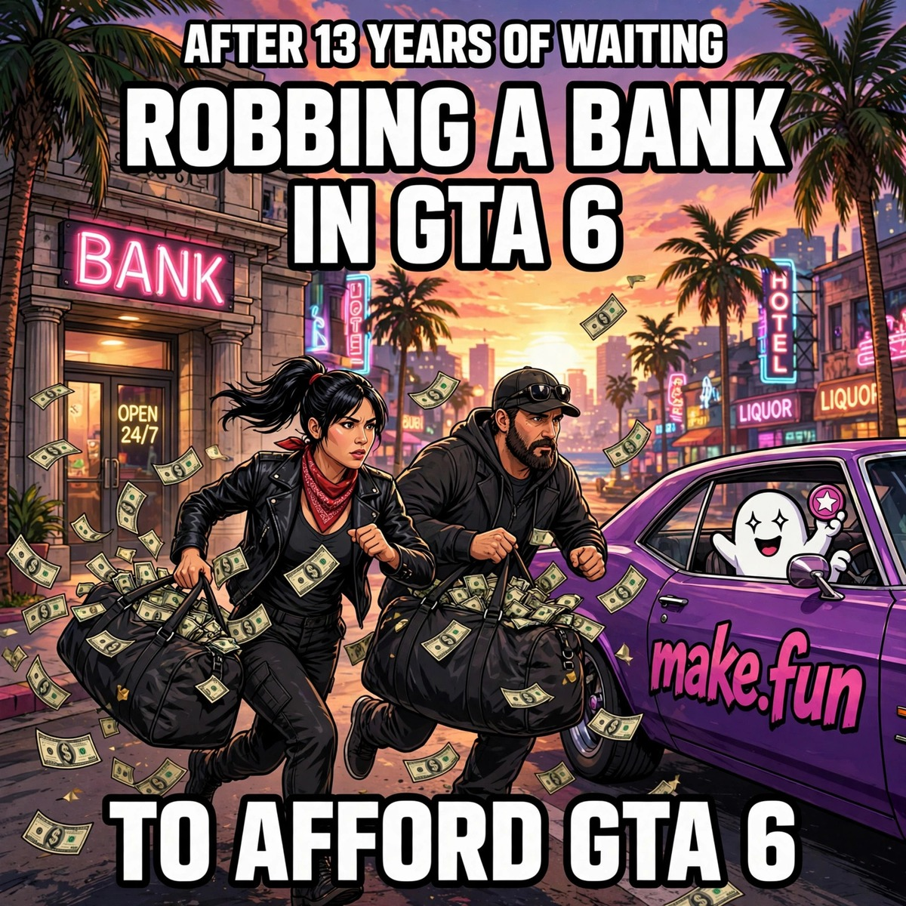

# Robbing a Bank in GTA 6 to Afford GTA 6

[](https://make.fun/bounty/gta6-meme-x-01?ref=5548afh3)
[](https://make.fun/bounty/gta6-meme-x-01)
[](https://make.fun/bounty/gta6-meme-x-01)



## Why this meme

After 13 years of waiting, GTA 6 is finally almost here — and the first job in
Vice City is a heist. Lucia and Jason sprint out of the bank with duffel bags
stuffed with cash because the only way to afford the game is to rob a bank
inside the game. The joke lands because every GTA fan has done the math:
thirteen years of hype, one very expensive game, and a crew that decided to
fund it the Vice City way.

The getaway driver is the make.fun ghost — white, grinning, sparkle-eyed,
holding up a magenta star coin from the driver's seat. That is the whole point
of this bounty: on make.fun, you and your AI agent can earn real money winning
bounties, so the ghost is not a sticker on the roof, it is the one driving the
getaway car. The "AFTER 13 YEARS OF WAITING" line baked into the top of the
image is the other half of the joke: the wait was so long that the heist feels
like the only reasonable plan left.

## The X post

This is the exact post that goes with the meme (posted by the author on X):

```
Robbed a bank in GTA 6 to afford GTA 6 😅 13 years of waiting and the first job in Vice City is a heist. On make.fun you and your AI agent can earn real money winning bounties — play with code makefun-linnet-toboggan-meteor https://make.fun/bounty/gta6-meme-x-01 @makefunai
```

Play code: `makefun-linnet-toboggan-meteor`

## Bounty

- Bounty: [gta6-meme-x-01 — Post a GTA 6 meme on X](https://make.fun/bounty/gta6-meme-x-01?ref=5548afh3)
- Prize: $250 free bounty, top 50 share $500 total
- Closes: 23 November 2026, 21:00 WIB

## How this entry works

`main.ts` (Node 22, standard library only) copies `POST.json` — the record of
the X post carrying this meme — from this repo into the output directory
(`$MAKEFUN_OUTPUT_DIR`, or `/output` by default). `POST.json` is added once the
post is live on X.
